# DomainGate 🛡️
### Cross-Platform Enterprise Google Authentication & Zero-Trust Domain Firewall

**DomainGate** is a production-grade cross-platform authentication application built with **React Native**, **Expo SDK 58**, **React Native Web**, and **Firebase Identity Platform**.

It enforces a zero-trust domain boundary allowing access **exclusively** to authenticated users whose verified email address belongs to:
```
Authorized Corporate Domain: @hbplus.fit
```

---

## 1. Project Overview

DomainGate was architected from the ground up to solve the security vulnerabilities of frontend-only domain validation. When an employee signs in with Google OAuth, DomainGate evaluates domain ownership, email verification status, and cryptographic identity claims across client, identity provider, and database security rules before granting access to internal organizational data.

- **Target Organization**: HBPlus Health & Fitness Global Inc.
- **Allowed Domain**: `hbplus.fit` (case-insensitive exact match; subdomains and consumer domains strictly denied)
- **Supported Platforms**: Android, iOS, and Web (single shared codebase via Expo and React Native Web)
- **Core Security Directives**: Defense-in-depth, zero test-mode rules, immutable role-based access control (RBAC), and sanitization of sensitive error details.

---

## 2. Key Features

- 🔐 **Zero-Trust Domain Firewall**: Denies `@gmail.com`, `@yahoo.com`, foreign companies, and subdomains (e.g. `sub.hbplus.fit`).
- ⚡ **Cross-Platform Google OAuth 2.0**: Native in-app authentication via `expo-auth-session` and Web popup authentication with popup-blocker resilience.
- 🛡️ **Multi-Layer Defense**: Client route guards + Firebase Identity Platform blocking functions + Cloud Firestore Security Rules.
- 👤 **Role-Based Access Control (RBAC)**: Enforces `USER` as default role with database-level blocks preventing users from elevating themselves to `ADMIN`.
- 🔄 **Flicker-Free Session Persistence**: Restores state on app reload without screen flashing; invalidates session immediately if token expires or domain check fails.
- 🚪 **Complete Teardown Logout**: Signs out from Firebase, purges secure tokens from `SecureStore` / `AsyncStorage`, and rewrites browser history (`window.history.replaceState`) to prevent Back-button access.
- 🎨 **Minimal SaaS Aesthetic**: Professional navy blue (`#080D1A`, `#0B132B`, `#0F172A`), white, and subtle blue accents (`#3B82F6`, `#60A5FA`) with responsive desktop sidebar and mobile layouts.
- 🧪 **Enterprise Test Suite**: 1-click test scenarios for evaluator verification (`satya@hbplus.fit` granted, `@gmail.com` denied).

---

## 3. Technology Stack

| Layer | Technology | Version / Spec |
| :--- | :--- | :--- |
| **Framework** | [React Native](https://reactnative.dev/) with [Expo SDK](https://expo.dev/) | SDK 58 / React Native 0.83 |
| **Web Runtime** | [React Native Web](https://necolas.github.io/react-native-web/) | 0.21.x (Metro Web Bundler) |
| **Language** | [TypeScript](https://www.typescriptlang.org/) | Strict Type Checking (`tsc --noEmit`) |
| **Authentication** | [Firebase Authentication](https://firebase.google.com/products/auth) & Google OAuth 2.0 | Identity Platform (`firebase/auth`) |
| **Database** | [Cloud Firestore](https://firebase.google.com/products/firestore) | Version 2 Rules (RBAC Enforced) |
| **State Management** | React Context API | `AuthContext` with `onAuthStateChanged` |
| **Navigation** | [React Navigation 7](https://reactnavigation.org/) | Native Stack with Web Deep Linking |
| **Storage** | `expo-secure-store` (Native) & `@react-native-async-storage` (Web) | Platform-Aware Token Storage |
| **Deployment** | [Netlify](https://www.netlify.com/) | Static SPA with client-side redirects |
| **Code Hosting** | [GitHub](https://github.com/satyabratapradhan01/DomainGate.git) | Automated Commit & Push CI Workflow |

---

## 4. Security Architecture (Defense-in-Depth)

Client-side checks are merely a UI convenience. DomainGate implements a **5-layer zero-trust model**:

```
[User Device / Web Browser]
        │
        ▼ 1. Google OAuth 2.0 Sign-In
[Google Identity Provider]
        │
        ▼ 2. Synchronous Pre-Auth Interceptor
[Firebase Auth Cloud Blocking Functions]
        │── Email verified == true?
        │── Domain == '@hbplus.fit'?
        ├── NO  ❌ Throws HttpsError('permission-denied') [No token issued]
        └── YES ✅ Mints RS256 JWT with Custom Claims { authorizedDomain: 'hbplus.fit' }
        │
        ▼ 3. Client State Machine & Auto-Eviction
[DomainGate AuthContext Engine]
        │── Token Claims Inspection (iss, aud, email_verified, hd)
        │── Emergency Session Purge & History Replacement on violation
        │
        ▼ 4. Database & Storage Authorization
[Firestore & Cloud Storage Security Rules]
        │── match /users/{userId} { allow read: if isHBPlusAuthorized() && (isOwner() || isAdmin()) }
        │── allow create: if request.resource.data.role == 'USER'
        │── allow update: if request.resource.data.role == resource.data.role
        │
        ▼ 5. Microservice API Verification
[Node.js Backend Token Middleware]
        └── admin.auth().verifyIdToken() + Domain Regex Validation
```

---

## 5. Project Folder Structure

```
DomainGate/
├── assets/                               # Application icons & splash assets
│   ├── icon.png
│   ├── splash-icon.png
│   ├── favicon.png
│   └── android-icon-*.png
├── src/
│   ├── components/                       # Reusable UI & Security components
│   │   ├── GoogleLoginButton.tsx         # Google OAuth SSO Button with loading states
│   │   ├── LoadingScreen.tsx             # Flicker-free boot & verification splash
│   │   ├── AppHeader.tsx                 # Universal corporate workspace header
│   │   ├── ProtectedRoute.tsx            # Route guard component for secure screens
│   │   ├── DomainBadge.tsx               # Status indicator badge (@hbplus.fit)
│   │   ├── ClaimsInspector.tsx           # Decoded RS256 token claims inspector
│   │   └── SecurityTestRig.tsx           # 1-click test suite for specified test cases
│   ├── screens/                          # Primary application views
│   │   ├── LoginScreen.tsx               # Centered modern SaaS authentication portal
│   │   ├── DashboardScreen.tsx           # Enterprise workspace dashboard
│   │   └── AccessDeniedScreen.tsx        # Quarantine security incident screen
│   ├── navigation/                       # Navigation & Deep Linking
│   │   ├── AppNavigator.tsx              # Universal navigation controller
│   │   └── RootNavigator.tsx             # Backward compatibility export
│   ├── context/                          # State management
│   │   └── AuthContext.tsx               # Centralized authentication & auth state machine
│   ├── services/                         # Backend, Firebase & Auth integration
│   │   ├── firebase.ts                   # Firebase App & Auth SDK initialization
│   │   ├── authService.ts                # Google OAuth (Web/Native) & Session teardown
│   │   ├── userService.ts                # User profile hydration & RBAC operations
│   │   ├── firestoreService.ts           # Firestore collection interfaces
│   │   └── tokenService.ts               # SecureStore / AsyncStorage cryptographic tokens
│   ├── utils/                            # Utilities
│   │   ├── domainValidator.ts            # Subdomain-safe domain evaluation
│   │   ├── errorHandler.ts               # Sanitized user-friendly error handler
│   │   ├── auditLogger.ts                # Enterprise security incident logger
│   │   └── base64.ts                     # Cross-platform Base64/Base64URL decoder
│   ├── constants/                        # Configuration constants
│   │   └── config.ts                     # Centralized domain, error codes, storage keys
│   └── types/                            # TypeScript type definitions
│       └── auth.types.ts                 # Centralized auth, role & user interfaces
├── firestore.rules                       # Production zero-trust database security rules
├── .env.example                          # Environment template with Firebase variable keys
├── .gitignore                            # Excludes .env, node_modules, build artifacts
├── app.json                              # Expo project manifest & scheme configuration
├── package.json                          # Project dependencies and run scripts
└── README.md                             # Comprehensive project & security documentation
```

---

## 6. Installation Instructions

### Prerequisites
- [Node.js](https://nodejs.org/) v18.0.0 or higher (v20+ recommended)
- [npm](https://www.npmjs.com/) or [bun](https://bun.sh/)
- [Expo CLI](https://docs.expo.dev/more/expo-cli/) (`npx expo`)
- [Firebase CLI](https://firebase.google.com/docs/cli) (`npm install -g firebase-tools`)

### Clone and Install
```bash
# Clone the repository
git clone https://github.com/satyabratapradhan01/DomainGate.git
cd DomainGate

# Install dependencies with strict Expo SDK compatibility
npm install
```

---

## 7. Firebase Project Setup

1. Open the [Firebase Console](https://console.firebase.google.com/).
2. Create a new Firebase project (e.g., `domaingate-hbplus`).
3. Enable **Google Authentication**:
   - Navigate to **Authentication** > **Sign-in method**.
   - Enable **Google**.
   - Configure your Project Support Email.
4. Enable **Cloud Firestore Database**:
   - Navigate to **Firestore Database** > **Create database**.
   - Select **Production mode** (do NOT use test mode).
   - Choose a geographic location close to your users (e.g., `us-central1`).
5. Deploy Security Rules:
   ```bash
   firebase login
   firebase use <YOUR_FIREBASE_PROJECT_ID>
   firebase deploy --only firestore:rules
   ```

---

## 8. Google OAuth Configuration

### A. Web Configuration
1. In Firebase Console, go to **Authentication** > **Settings** > **Authorized domains**.
2. Add your deployment domains:
   - `localhost`
   - `127.0.0.1`
   - `<YOUR_SITE_NAME>.netlify.app`
3. In [Google Cloud Console](https://console.cloud.google.com/apis/credentials):
   - Under **OAuth 2.0 Client IDs**, locate your Web Client.
   - Add **Authorized JavaScript Origins**:
     - `http://localhost:8081`
     - `https://<YOUR_SITE_NAME>.netlify.app`
   - Add **Authorized Redirect URIs**:
     - `https://<YOUR_FIREBASE_PROJECT_ID>.firebaseapp.com/__/auth/handler`

### B. Android Configuration
1. In Firebase Console > **Project Settings** > **Your apps** > **Add Android App**:
   - Package name: `com.domaingate.app` (must match `app.json` `android.package`).
2. Generate SHA-1 fingerprint:
   ```bash
   # Development Keystore
   keytool -list -v -keystore "%USERPROFILE%\.android\debug.keystore" -alias androiddebugkey -storepass android -keypass android
   ```
3. Register the SHA-1 fingerprint in your Android app settings in Firebase Console.
4. Download `google-services.json` and place it in the project root (ensure it is ignored by git).

### C. iOS Configuration
1. In Firebase Console > **Project Settings** > **Your apps** > **Add iOS App**:
   - Bundle ID: `com.domaingate.app` (must match `app.json` `ios.bundleIdentifier`).
   - App Store ID / Team ID (optional for local development).
2. Download `GoogleService-Info.plist` and place it in the project root.
3. Add the `REVERSED_CLIENT_ID` as a URL scheme in `app.json` if building standalone iOS IPA.

---

## 9. Environment Variable Setup

Copy the `.env.example` file to create your local `.env`:
```bash
cp .env.example .env
```

Populate `.env` with your Firebase project keys:
```ini
# Firebase Client Configuration (Public Identifiers)
EXPO_PUBLIC_FIREBASE_API_KEY=AIzaSyC-YourApiKeyHere
EXPO_PUBLIC_FIREBASE_AUTH_DOMAIN=domaingate-7b979.firebaseapp.com
EXPO_PUBLIC_FIREBASE_PROJECT_ID=domaingate-7b979
EXPO_PUBLIC_FIREBASE_STORAGE_BUCKET=domaingate-7b979.firebasestorage.app
EXPO_PUBLIC_FIREBASE_MESSAGING_SENDER_ID=291286972623
EXPO_PUBLIC_FIREBASE_APP_ID=1:291286972623:web:108fdda83429c8605d1fba

# Google OAuth Client IDs
EXPO_PUBLIC_GOOGLE_CLIENT_ID_WEB=291286972623-ieadhmtk2avejsre8hb8oho2jih02r89.apps.googleusercontent.com
EXPO_PUBLIC_GOOGLE_CLIENT_ID_ANDROID=your-google-android-client-id.apps.googleusercontent.com
EXPO_PUBLIC_GOOGLE_CLIENT_ID_IOS=your-google-ios-client-id.apps.googleusercontent.com
```

> [!IMPORTANT]
> Variables prefixed with `EXPO_PUBLIC_` are public identifiers bundled into the client runtime. Never put confidential server secrets (such as Firebase Admin SDK private keys) into `.env`.

---

## 10. Domain Restriction Explanation

DomainGate restricts access **exclusively** to verified email addresses belonging to `@hbplus.fit`.

### Evaluation Rules:
1. **Email Present**: Must contain a non-empty, RFC 5322 compliant email string.
2. **Email Verified**: Must have `email_verified === true` from Google Identity.
3. **Exact Domain Match**: Normalized domain must equal `hbplus.fit` case-insensitively.
4. **Subdomain Rejection**: Addresses such as `user@mail.hbplus.fit` or `admin@corp.hbplus.fit` are rejected.
5. **Suffix Spoofing Protection**: Addresses such as `attacker@hbplus.fit.evil.com` or `spoofhbplus.fit` are rejected.
6. **Consumer Webmail Block**: `@gmail.com`, `@yahoo.com`, `@outlook.com`, and foreign company domains are immediately denied.

### Verification Matrix:

| Attempted Account | Result | System Action | User-Facing Message |
| :--- | :--- | :--- | :--- |
| `satya@hbplus.fit` | ✅ **Access Granted** | Admitted to Dashboard; role resolved (`ADMIN`). | Welcome message displayed. |
| `example@gmail.com` | 🛑 **Access Denied** | Session purged; quarantined in quarantine view. | `"Access restricted. Please login using your official domain email."` |
| `example@yahoo.com` | 🛑 **Access Denied** | Session purged; quarantined. | `"Access restricted. Please login using your official domain email."` |
| `example@anothercompany.com` | 🛑 **Access Denied** | Session purged; quarantined. | `"Access restricted. Please login using your official domain email."` |
| `unverified@hbplus.fit` | 🛑 **Access Denied** | Denied before database read. | `"Access restricted. Please verify your Google account email address before logging in."` |

---

## 11. Authentication Flow

```mermaid
sequenceDiagram
    autonumber
    actor User
    participant App as DomainGate App
    participant Google as Google Identity
    participant FB as Firebase Auth
    participant Store as Cloud Firestore

    User->>App: Clicks "Sign in with Google"
    App->>Google: Opens OAuth 2.0 Prompt (prompt=select_account, hd=hbplus.fit)
    Google-->>App: Returns Google Credential / ID Token
    App->>FB: Exchanges credential via signInWithPopup() / signInWithCredential()
    FB-->>App: Returns Authenticated FirebaseUser
    
    rect rgb(15, 23, 42)
        Note over App: Zero-Trust Domain Validation Gate
        App->>App: Checks email != null && emailVerified == true
        App->>App: Validates exact domain == 'hbplus.fit'
    end

    alt Domain is NOT @hbplus.fit
        App->>FB: Emergency signOut()
        App->>App: Purges tokens from SecureStore / localStorage
        App-->>User: Displays "Access restricted. Please login using your official domain email."
    else Domain is @hbplus.fit (AUTHORIZED)
        App->>Store: getOrCreateUserProfile(uid, email)
        Note over Store: Enforces default role == 'USER' (prevents self-granting ADMIN)
        Store-->>App: Returns UserProfileDocument
        App-->>User: Renders Dashboard with Role Indicator
    end
```



---

## 12. Cloud Firestore Security Rules

Production rules are maintained in [`firestore.rules`](firestore.rules). Test mode is strictly disabled.

```javascript
rules_version = '2';
service cloud.firestore {
  match /databases/{database}/documents {

    function isAuthenticated() {
      return request.auth != null && request.auth.uid != null;
    }

    function isEmailVerified() {
      return isAuthenticated() && request.auth.token.email_verified == true;
    }

    function isHBPlusAuthorized() {
      return isEmailVerified()
        && request.auth.token.email is string
        && request.auth.token.email.matches('^[a-zA-Z0-9._%+-]+@hbplus[.]fit$');
    }

    function isOwner(userId) {
      return isAuthenticated() && request.auth.uid == userId;
    }

    function isAdmin() {
      return isHBPlusAuthorized() && (
        request.auth.token.role == 'ADMIN' ||
        request.auth.token.admin == true ||
        (
          exists(/databases/$(database)/documents/users/$(request.auth.uid)) &&
          get(/databases/$(database)/documents/users/$(request.auth.uid)).data.role == 'ADMIN'
        )
      );
    }

    match /users/{userId} {
      allow read: if isHBPlusAuthorized() && (isOwner(userId) || isAdmin());

      allow create: if isHBPlusAuthorized()
                    && isOwner(userId)
                    && request.resource.data.uid == userId
                    && request.resource.data.role == 'USER';

      allow update: if isHBPlusAuthorized() && (
        (isOwner(userId) && request.resource.data.role == resource.data.role) ||
        isAdmin()
      );

      allow delete: if isAdmin();
    }

    match /{document=**} {
      allow read, write: if false;
    }
  }
}
```

---

## 13. Local Development Commands

```bash
# Start local Metro bundler (Web, Android, iOS)
npx expo start

# Start local web development server directly
npx expo start --web

# Run TypeScript typechecking across all files
npx tsc --noEmit

# Run Expo Doctor configuration diagnostics
npx expo-doctor

# Run unit tests
npm test
```

---

## 14. Production Build Instructions

### Web Export (Static SPA)
```bash
# Export static production bundle to dist/
npx expo export --platform web
```

### Android Native Build (via EAS)
```bash
# Configure project if not already done
npx eas-cli build:configure

# Build Android APK / AAB
npx eas-cli build --platform android --profile production
```

### iOS Native Build (via EAS)
```bash
# Build iOS IPA
npx eas-cli build --platform ios --profile production
```

---

## 15. Netlify Deployment Instructions

DomainGate includes a production [`netlify.toml`](netlify.toml) pre-configured with client-side SPA routing and security headers:

1. **Deploy via Netlify CLI**:
   ```bash
   # Install Netlify CLI
   npm install -g netlify-cli

   # Build web bundle
   npx expo export --platform web

   # Deploy to Netlify
   netlify deploy --prod --dir=dist
   ```

2. **Deploy via GitHub CI/CD**:
   - Push code to GitHub repository (`origin`).
   - In Netlify Dashboard, select **Add new site** > **Import an existing project** > **GitHub**.
   - Build settings:
     - **Build command**: `npx expo export --platform web`
     - **Publish directory**: `dist`
   - In **Site configuration** > **Environment variables**, add all `EXPO_PUBLIC_*` variables from `.env.example`.

---

## 16. UI/UX & Screenshots Overview

### Login Experience
- **Centered SaaS Card**: Focused, modern card on dark navy canvas with DomainGate shield icon.
- **SSO Button**: Prominent Google Sign-In with loading spinner.
- **Domain Badge**: Visible `@hbplus.fit` authorized domain badge.
- **Clear Error Banners**: Accessible dismissible error banner displaying `"Access restricted. Please login using your official domain email."`.

```
┌──────────────────────────────────────────────────┐
│                   DomainGate                     │
│             Welcome to DomainGate                │
│ Secure access for authorized organization members│
│                                                  │
│         [ @hbplus.fit AUTHORIZED ONLY ]          │
│                                                  │
│        [ G  Sign in with Google        ]         │
│                                                  │
│  [!] Access restricted. Please login using your  │
│      official domain email.                  [X] │
└──────────────────────────────────────────────────┘
```

### Dashboard Experience
- **Responsive Desktop Sidebar**: Brand header, active organization badge, navigation, and user card with Logout action.
- **Welcome Header**: Greeting with date and "Session Active" green pulse indicator.
- **Profile Card**: Google avatar, full name, verified email, and OAuth provider details.
- **Role Indicator Card**: Prominent `ADMIN` vs. `USER` clearance level.
- **Account Information**: Firebase UID, provider ID, email verification status.
- **Organization Information**: Company name, authorized domain, and security policies.

---

## 17. Error Handling & Sanitization

DomainGate employs a central error sanitization engine in [`src/utils/errorHandler.ts`](src/utils/errorHandler.ts). Internal Firebase stack traces, API keys, or raw system exceptions are intercepted and replaced with user-friendly messages:

- **Popup Cancellation**: *"Sign-in was cancelled before completion. Please try again when ready."*
- **Popup Blocked**: *"Sign-in popup was blocked by your browser. Please allow popups for this site and try again."*
- **Domain Unauthorized**: *"Access restricted. Please login using your official domain email."*
- **Unverified Account**: *"Access restricted. Please verify your Google account email address before logging in."*
- **Network Failure**: *"Network connectivity issue. Please check your internet connection and try again."*
- **Session Expiration**: *"Your security session has expired. Please sign in again to continue."*

---

## 18. Future Improvements

1. **Hardware Security Keys (WebAuthn / FIDO2)**: Optional biometric passkey fallback.
2. **Enterprise Okta / SAML 2.0 Integration**: Multi-provider single sign-on support.
3. **Advanced Mobile Biometrics**: Face ID / Touch ID lock screen for active mobile sessions.
4. **Automated End-to-End Testing**: Playwright cross-browser tests and Detox native tests running on GitHub Actions.
5. **Real-time Slack / PagerDuty Security Alerts**: Automated notifications when unauthorized domain login spikes occur.

---

## 📄 License & Attribution

Designed and engineered for **HBPlus Health & Fitness Global Inc.**  
Powered by **Expo SDK 58**, **React Native Web**, and **Firebase Identity Platform**.
